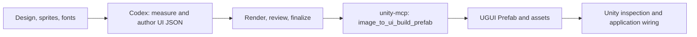

# Image to UI

[中文说明](README.zh-CN.md) · [Complete workflow](#complete-workflow) · [Unity command reference](Unity/README.md)

Use Codex to turn a UI design and sliced assets into reviewed `ui_structure.json`,
then assemble a Unity UGUI Prefab through CoplayDev `unity-mcp`. Analysis, validation,
and export run as one continuous task.

Install `unity-mcp` and this repository's
`Unity/` package in the target project, finish the same analysis and finalization,
then generate MCP requests with `workspace.py build-requests --backend mcp`.
Confirm the connected Unity project and discover `image_to_ui_build_prefab` in
`mcpforunity://custom-tools` before passing each request's `params` to
`execute_custom_tool`. Existing
Prefab targets are skipped; see [Unity MCP setup](Unity/README.md#使用-unity-mcp).

The Prefab uses native UGUI components and generated assets. All declared states
are preserved as visibility branches, with only the current state active.
Developers own application control; no custom runtime scripts are generated.

## Multi-project, multi-page workspaces

Use a versioned `ui_workspace.json` to coordinate several games and pages while keeping the original single-page workflow. See [`examples/ui_workspace.example.json`](examples/ui_workspace.example.json). Each project declares an asset root and common asset directories; each page declares its own design, local asset directories, output folder and Prefab path. Paths are relative to the manifest except asset directory entries, which are relative to `assetRoot`.

Use the [UI asset naming convention](docs/asset-naming.md) for new shared and page-specific source images. It defines short scope, type, and state abbreviations and keeps filenames unique within each game for later AssetBundle packaging. The existing `hund/market` sprites still use type-based directories and older names; the convention documents a gradual migration and does not require renaming them.

```bash
python -B image-to-ui/scripts/workspace.py validate --manifest ui_workspace.json
python -B image-to-ui/scripts/workspace.py overview --manifest ui_workspace.json
python -B image-to-ui/scripts/workspace.py prepare --manifest ui_workspace.json --project emberfall
python -B image-to-ui/scripts/workspace.py check --manifest ui_workspace.json --project emberfall --page market
python -B image-to-ui/scripts/workspace.py finalize --manifest ui_workspace.json --project emberfall --page market
python -B image-to-ui/scripts/workspace.py report --manifest ui_workspace.json
python -B image-to-ui/scripts/workspace.py build-requests --backend mcp --manifest ui_workspace.json
```

`overview` creates `workspace_overview.png` and a JSON page index beside the manifest, showing all selected designs together before decomposition. The coordinator runs the existing analysis workflow independently for each page. It builds a page-scoped symlink view of common and local art in `.image-to-ui-cache`. `report` identifies exact-byte shared assets referenced by multiple pages and validates optional functional contracts: button action IDs, button navigation targets, and text data keys. It writes `integration_contract.json` for developers; it does not infer gameplay behavior. States, progress and scroll still belong in each page's `ui_structure.json`.

`build-requests --backend mcp` emits safe `image_to_ui_build_prefab` requests for completed pages only, never overwrites an existing Prefab, and leaves MCP tool calls to the agent. Each request identifies its Unity project; a cross-project batch requires `unityProject` for every selected project. Confirm the active Unity Editor matches that path before sending each request. Put truly shared Unity art under `Assets/` and reference it directly from each page; external art can be copied into each generated Prefab's resource folder. The sample manifest uses the repository's single test design in several illustrative slots; replace those paths with real page designs.

### How to use a workspace

1. Arrange each game's original design images and independent PNG sprites. A flat design image alone is insufficient for `prepare`: sprite extraction must happen first. Give each page its own design and output directory; place shared art in a project-level directory such as `sprites/Common` and page art in directories such as `sprites/Pages/market`.
2. Copy [`examples/ui_workspace.example.json`](examples/ui_workspace.example.json) to `ui_workspace.json` at the repository root. Replace the illustrative image and sprite paths, add each game's `unityProject`, and give every page a unique `prefabPath`. Paths are relative to the manifest directory, except `commonAssetDirs` and `assetDirs`, which are relative to `assetRoot`. Add a page to its project's `pages` array; add a game to `projects`.
3. Run `validate`, then `overview` to compare all page designs. Run `prepare` with `--project GAME` and optionally `--page PAGE`. Without a project filter, commands select all games. The coordinator creates a page-specific `.image-to-ui-cache` asset view without moving source sprites.
4. For **each page**, write `ui_structure.json` in that page's `output` directory using the grid and asset inventory produced by `prepare`. `prepare` does not generate the structure. Run `check`, review `comparison.png`, `reconstruction.png`, element and risk views, and repeat after corrections. Preview alternate sizes, states, progress, and scroll where applicable. Complete `alignment_review.md` and any needed `component_review.md`, then run `finalize`. The page is exportable only when `completion_report.json` contains `"complete": true` and the structure has not changed since finalization. Follow [`image-to-ui/SKILL.md`](image-to-ui/SKILL.md) for the full review protocol.
5. Run `report` to inspect `workspace_report.json`. It identifies assets with identical bytes used on multiple pages **within the same game**. Review visually similar files yourself; the tool does not merge them. After moving confirmed shared art into the common directory and updating references, rerun `prepare`, `check`, review, and `finalize` for affected pages.
6. Run `build-requests --backend mcp` to write `workspace_mcp_build_requests.json`. This command does **not** call Unity. Check `mcpforunity://project/info` and discover `image_to_ui_build_prefab` in `mcpforunity://custom-tools`, then pass each request's `params` to `execute_custom_tool(tool_name="image_to_ui_build_prefab", parameters=...)` when project-scoped custom tools are enabled. Match the active Unity project to each request's `unityProject`, send requests one at a time, and inspect the resulting Prefabs. Existing Prefab targets are skipped and `overwrite` is always `false`. The older UnityAgentBridge adapter remains available with `--backend bridge`.

The optional page `functional` object maps button paths to action IDs (`actions`), button paths to page IDs in the same game (`navigation`), and text paths to data keys (`bindings`). `report` validates these paths against `ui_structure.json` and writes each page's `integration_contract.json`. Connect the behavior in your game's runtime code; the Prefab exporter does not implement game rules. See the [Chinese walkthrough](README.zh-CN.md#多项目与多页面工作区) for a field table and example contract.

## Complete workflow

Give Codex the complete task: analyze the design, generate and review the
structure, then use `unity-mcp` to assemble a Prefab. Finish by inspecting
the Unity result and wiring application behavior.



### 1. Prepare the environment and install the Unity packages

Prepare Git, Python 3.10+, and a target Unity 2022.3+ project. Clone the
repository into your preferred working directory:

```bash
git clone https://github.com/osunkingo/Image-To-UI.git
```

Codex reads the skill, scripts, and examples from this checkout.
Install the Unity packages from GitHub as below.

The analysis scripts need Pillow and NumPy:

```bash
python -m pip install pillow numpy
```

On Windows, `py` can replace `python`.

Ensure Git is available to Unity. In the target project's Package Manager,
use **Add package from git URL** to install:

1. `https://github.com/CoplayDev/unity-mcp.git?path=/MCPForUnity#main`
2. `https://github.com/osunkingo/Image-To-UI.git?path=Unity`

The second URL points to this repository's `Unity/package.json`. Alternatively,
merge these entries into the project's `Packages/manifest.json`, retaining
its other dependencies:

```json
{
  "dependencies": {
    "com.coplaydev.unity-mcp": "https://github.com/CoplayDev/unity-mcp.git?path=/MCPForUnity#main",
    "me.xw.imagetoui": "https://github.com/osunkingo/Image-To-UI.git?path=Unity"
  }
}
```

Wait for compilation with no Console errors. Stay in Edit Mode and connect
`unity-mcp` using **Window > MCP for Unity > Configure All Detected Clients**.
Check `mcpforunity://custom-tools` for `image_to_ui_build_prefab` and keep the
target project open.

### 2. Identify this run's inputs and outputs

Open this repository in Codex and explicitly use its
[`image-to-ui/SKILL.md`](image-to-ui/SKILL.md). The following file paths are
relative to the repository root:

| Item | Path |
| --- | --- |
| Design | `test/source/design/emberfall-ui-mockup.png` |
| Sprite root | `test/source/sprites` |
| Fresh analysis output | `test/output-local` |
| JSON to be generated | `test/output-local/ui_structure.json` |
| Unity project | Supply its absolute path, containing `Assets/` and `Packages/`. |
| Prefab output | `Assets/Generated/EmberfallMainUI.prefab` inside that Unity project. |

Use a separate fresh output directory for each new design. The checked-in
`test/output` is an existing example; this workflow consistently uses
`test/output-local`, including the JSON passed to Unity.

Provide intended fonts, alternate-state designs, scroll extents, and adaptation
requirements when available. Document inferred behavior and unavailable artwork
or fonts as uncertainties or approximations.
Use a native-resolution PNG/JPG design and preserve sprite-relative paths.
Optional Unity `.png.meta` borders and TTF/OTF fonts help preserve the intended
appearance in the exported Prefab.

### 3. Give Codex the complete task

After installing the packages, copy this request and fill in the Unity project
path. Codex runs the subsequent analysis, validation, and export stages; the
commands below explain the process and help with troubleshooting.

```text
Use this repository's image-to-ui/SKILL.md to complete the workflow
from the design image to a Unity Prefab.

Design: test/source/design/emberfall-ui-mockup.png
Sprite root: test/source/sprites
Fresh analysis output: test/output-local
Target Unity project: <absolute Unity project path>
Prefab output: Assets/Generated/EmberfallMainUI.prefab

Check mcpforunity://project/info for the target Unity project and discover
image_to_ui_build_prefab in mcpforunity://custom-tools before export.

Run prepare, measure the design, and author ui_structure.json.
Represent hierarchy, anchors/responsive constraints, states, progress bars,
and scroll regions. Iterate with check and inspect the reconstruction.
Use measure, target, and component preview where needed.
Complete element and applicable component reviews, run finalize, and verify
that this run's completion_report.json has complete: true.

Then call image_to_ui_build_prefab through unity-mcp's execute_custom_tool using the new
ui_structure.json from this run and the sprite root above.
Assemble native UGUI objects and resources. Generate all declared states as
visibility branches, with only the current state initially active.
Leave application control to developers and add no custom runtime scripts.
If the destination already exists, preserve it and report the conflict unless
I have explicitly requested overwrite.

Confirm that the Prefab loads in Unity, inspect resource references and state
branches, and report the JSON, comparison, Prefab, and resource directory paths,
including warnings, approximations, and verification results.
```

### 4. Codex measures the design and authors JSON

From the repository directory, Codex starts with:

```bash
python -B image-to-ui/scripts/workflow.py prepare --design test/source/design/emberfall-ui-mockup.png --assets test/source/sprites --output test/output-local
```

This generates the grid, asset inventory, and contact sheets. Codex uses them
to identify layers, measure parent-relative geometry, select sprites/fonts,
and write `test/output-local/ui_structure.json`. Small details can be
inspected with pixel-preserving `measure` crops.

Every node carries an anchor; `responsive` describes actual size constraints.
Use `state`, `progress`, and `scroll` for the corresponding components.
See the [schema](image-to-ui/references/schema.md) and
[component guide](image-to-ui/references/components.md) for their contracts.

### 5. Codex validates, reviews, and finalizes the analysis

After authoring or editing JSON:

```bash
python -B image-to-ui/scripts/workflow.py check --output test/output-local
```

Codex inspects `comparison.png`, element boxes, and audit reports, then
corrects geometry, assets, text, and layers. Use `target` for ambiguous areas
and `preview` for declared states, progress, scroll positions, and size
constraints. Record component findings in `component_review.md`.

After the latest successful check, write `alignment_review.md` with the
current review binding and run:

```bash
python -B image-to-ui/scripts/workflow.py finalize --output test/output-local
```

`"complete": true` in `completion_report.json` completes the native-design
analysis stage. Continue with the Unity export; that flag does not certify
that a Unity asset has been generated or inspected.

### 6. Codex generates the Prefab through unity-mcp

Call `execute_custom_tool` with `tool_name="image_to_ui_build_prefab"` using the
discovered MCP tool schema. Its input is the
JSON just generated and reviewed in this run. Codex replaces `<repo>` with
the absolute repository path before calling Unity:

```json
{
  "tool_name": "image_to_ui_build_prefab",
  "parameters": {
    "structurePath": "<repo>/test/output-local/ui_structure.json",
    "assetsPath": "<repo>/test/source/sprites",
    "prefabPath": "Assets/Generated/EmberfallMainUI.prefab"
  }
}
```

Pass the `parameters` object to `execute_custom_tool` after verifying the connected
Unity project and tool registration.
Use explicit `overwrite: true` when replacing an existing asset; use `fontMap`
for differing font paths. See the [Unity command reference](Unity/README.md#生成-prefab).

For the MCP tool, `assetsPath` is one directory string. Put shared and page
assets in subdirectories of that root. The optional UnityAgentBridge adapter
also accepts an array of directories.

Unity assembles native UGUI objects and references existing project sprites and
fonts directly. Only external imports and necessary derived assets use the
stable, reusable `<PrefabName>_Resources` directory before saving the Prefab. Declared states become
`States/<state>/Content` branches; only the current state starts active.
No custom runtime scripts are added.

Codex reads the returned `prefabPath`, `guid`, `resourceFolder`,
`stateObjects`, and `warnings`, confirms the asset loads, and reports any
remaining issues.

### 7. Inspect and use the Prefab in Unity

Open the generated asset in the Project window. Inspect layout, text, images,
and clipping at the design resolution and intended Game View sizes. Unity
font metrics can differ from Python previews. For corrections, update JSON
and repeat `check → review → finalize → image_to_ui_build_prefab`.

Drag the Prefab into the scene. It includes Canvas, CanvasScaler, and
GraphicRaycaster and is normally used as a scene root. Keep the returned
resource directory because the Prefab references those assets.

Developers switch state GameObjects with their active checkbox or `SetActive`
and wire button actions, progress updates, and application data. Pointer and
scroll input require an EventSystem with the project's appropriate input module.

Deliver the current JSON, comparison/review artifacts, Unity Prefab, generated
resources, and warnings/approximations. The complete Prefab task includes both
the analysis stage and Unity generation/inspection.

For an existing usable JSON, start at step 6. Installation details, font
mapping, and troubleshooting remain in the [Unity exporter reference](Unity/README.md).

## Output artifacts

| Artifact | Purpose |
| --- | --- |
| `ui_structure.json` | Engine-oriented UI hierarchy, anchors, geometry, text, and asset references. |
| `reconstruction.png` | Rendered result from the current structure. |
| `comparison.png` | Gridded design and reconstruction shown side by side. |
| `all_elements.png` / `all_elements_legend.json` | Overview of resolved element bounds, paths, and explicit list roles. |
| `target_*.png` / `target_*_legend.json` | Optional focused evidence for crowded regions. |
| `render_trace.json` | Resolved bboxes, visible pixels, fonts, layers, and render details. |
| `validate_report.json` / `visual_audit.json` | Structural and rendered-output diagnostics. |
| `alignment_review.md` | Human/AI review record for every foreground element. |
| `completion_report.json` | Native-design analysis completion, coverage, warnings, and approximations. |
| `workflow_state.json` | Input snapshots, revisions, checks, and resumable workflow state. |
| `previews/` / `component_review.md` | Alternate size/state/progress/scroll scenarios and their review, separate from native completion. |
| `measurements/` | Optional local design crops, pixel rulers, and crop/zoom mappings. |
| `assets/` and `design_grid.*` | Asset inventories, contact sheets, and grid measurements. |
| Target `.prefab` inside the Unity project | The final editable UGUI Prefab. |
| Unity tool result: `resourceFolder` / `resourceUsage` | Optional generated-resource folder (null for direct references only) and reference/copy/reuse counts. |
| Unity tool result: `stateObjects` / `warnings` | Actual state hierarchy paths, initial visibility, and import warnings. |

The checked-in `test/output` is a compact example: structure JSON, comparison,
reconstruction, state/resolution overview images, and `component_review.md`.
Intermediate grids, inventories, traces, per-scenario outputs, and machine-local
workflow records are generated in local runs such as `test/output-local` and
are not committed. Start a fresh local workflow to regenerate full evidence.

## Example: Emberfall HUD

This repository includes a complete example:

- Design: [`test/source/design/emberfall-ui-mockup.png`](test/source/design/emberfall-ui-mockup.png)
- Sliced sprites: [`test/source/sprites/`](test/source/sprites/)
- Final structure: [`test/output/ui_structure.json`](test/output/ui_structure.json)
- Completion report: generated during a full local workflow run (`test/output-local/completion_report.json`).

[](test/output/comparison.png)

The checked-in run reconstructs a `1672 × 941` HUD with:

- 71 structured elements;
- 71/71 nodes with required anchor alignment metadata;
- 42 sprite references;
- 5 row/column layouts;
- 1 explicitly identified quest list with 2 list items;
- 70/70 reviewed element paths;
- zero validation or visual-audit warnings.

The mockup also contains artwork that was not supplied as a sliced sprite.
Those limits—such as the hero/portrait layer and font substitutions—are
recorded explicitly in `metadata.approximations` instead of being hidden.

The final review used focused evidence to correct the lower-right `ENTER`
button and both QUEST row backgrounds. Those focused images are generated
during a full local workflow run and are not included in the compact example.

## Highlights

- Grid-based measurement at the design's native resolution, with optional
  pixel-preserving local crops and absolute-pixel rulers.
- Transparent sprite padding and alpha-core bounds for more accurate placement.
- Recursive PNG/JPG sprite inventory with duplicate-name detection and optional
  Unity `.png.meta` border support.
- Structured containers, rows, columns, images, text, generated rectangles, and
  overlays.
- Linear progress bars with numeric ranges, four fill directions, and label binding.
- State variants, clipped scroll viewports, responsive edge constraints, and safe areas.
- Separate previews for canvas size, state, progress value, and scroll offset.
- Required nine-position anchor alignment metadata on every structure node,
  with a migration tool for older JSON.
- Opt-in `list` / `listItem` roles chosen from explicit context or holistic
  visual semantics, then carried into element annotation legends.
- Nine-slice rendering, font tracing, tint, opacity, and hue-shift support.
- Strict structure validation plus visual-audit reports.
- Side-by-side comparison, element bounding boxes, and focused recheck images.
- Resumable workflow state and a final `completion_report.json`.

## Repository layout

```text
image-to-ui/
  SKILL.md
  agents/openai.yaml
  references/
  scripts/
Unity/
  package.json
  Editor/
  Tests/
test/
  source/
    design/
    sprites/
  output/
README.md
README.zh-CN.md
```

## License

[MIT](LICENSE)
