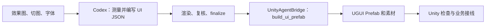

# Image to UI

[English](README.md) · [完整运行流程](#完整运行流程) · [Unity 命令参考](Unity/README.md)

使用 Codex 将 UI 效果图和切图转换为经过复核的 `ui_structure.json`，再通过
UnityAgentBridge 组装成 Unity UGUI Prefab。分析、校验与导入在同一项任务中连续完成。

也支持 CoplayDev 的 `unity-mcp`。先在 Unity 安装 `unity-mcp` 和本仓库的 `Unity/` 包，
完成同样的 prepare、结构编写、check 和 finalize 后运行：

```bash
python -B image-to-ui/scripts/workspace.py build-requests --backend mcp --manifest ui_workspace.json --project hund --page market
```

打开生成的 `workspace_mcp_build_requests.json`，确认 `unityProject` 对应当前连接的 Unity 工程。
让 Codex 读取 MCP 的 `mcpforunity://custom-tools`，确认存在 `image_to_ui_build_prefab`，
然后把该页面的 `params` 交给这个工具。工具仅在 Edit Mode 构建 Prefab，默认拒绝覆盖已有目标。
`assetsPath` 在 MCP 工具中传一个目录；共享素材可放在这个目录的子目录中。
详细安装和参数见 [Unity 导入器参考](Unity/README.md#使用-unity-mcp)。

生成的 Prefab 使用原生 UGUI 组件和素材。不同状态完整保存在显隐分组中，
默认只激活当前状态；业务控制由开发者实现，没有自定义运行时脚本依赖。

## 多项目与多页面工作区

多个游戏、多个页面使用一个 `ui_workspace.json` 管理；每页仍独立分析、复核并生成一个 Prefab。单页面命令继续可用。以下命令均在**仓库根目录**执行，使用 Python 3.10+；首次运行先安装 `python -m pip install pillow numpy`。

### 从你的 `market` 页面开始：最小可运行示例

先只配置**一个游戏、一个页面**。在本仓库根目录新建 `ui_workspace.json`，把下面内容完整复制进去：

```json
{
  "version": 1,
  "projects": [
    {
      "id": "hund",
      "assetRoot": "hund/source/sprites",
      "unityProject": "/Volumes/work/myself/testui",
      "commonAssetDirs": [],
      "pages": [
        {
          "id": "market",
          "design": "hund/source/design/market.png",
          "assetDirs": ["Backgrounds", "Cells", "Buttons", "Icons", "Decorations", "Sprites"],
          "output": "hund/output-workspace/market",
          "prefabPath": "Assets/Generated/MarketUI.prefab"
        }
      ]
    }
  ]
}
```

这里的 `assetRoot` 是切图总目录，`assetDirs` 是它下面允许本页使用的子目录；`output` 是新建的分析结果目录，不是切图目录。`unityProject` 指向现有 Unity 工程，`prefabPath` 是**工程内**将要创建的文件。你现有的 `Assets/Generated/EmberfallMainUI.prefab` 已存在，因此示例改用 `MarketUI.prefab`；若该文件以后也存在，请换一个新名字，工作区不会覆盖它。示例中的路径是本机路径；换电脑时需修改 `unityProject`。

接着在仓库根目录依次运行：

```bash
python -B image-to-ui/scripts/workspace.py validate --manifest ui_workspace.json
python -B image-to-ui/scripts/workspace.py overview --manifest ui_workspace.json
python -B image-to-ui/scripts/workspace.py prepare --manifest ui_workspace.json --project hund --page market
```

第一条应显示 `"valid": true`；第二条生成 `workspace_overview.png`，此时只有一页；第三条在 `hund/output-workspace/market/` 生成效果图网格、切图清单和素材预览。**到这里还没有 `ui_structure.json` 或 Prefab**：下一步需要让 Codex 按 [`image-to-ui/SKILL.md`](image-to-ui/SKILL.md) 测量效果图、编写 `hund/output-workspace/market/ui_structure.json`。你可以直接交代：“使用当前仓库的 image-to-ui Skill，基于 `ui_workspace.json` 的 `hund/market` 页面和 prepare 产物生成结构，完成 check、视觉复核与 finalize。”

结构写好后，运行下面的检查；每次调整结构后重新运行 `check`，在 `comparison.png` 中与原图对照，再完成 Skill 要求的复核文件：

```bash
python -B image-to-ui/scripts/workspace.py check --manifest ui_workspace.json --project hund --page market
python -B image-to-ui/scripts/workspace.py finalize --manifest ui_workspace.json --project hund --page market
python -B image-to-ui/scripts/workspace.py build-requests --manifest ui_workspace.json --project hund --page market
```

确认 `hund/output-workspace/market/completion_report.json` 中 `"complete": true`。最后一条只生成 `workspace_build_requests.json`，**不会自己打开 Unity 或创建 Prefab**；让 Codex 按 UnityAgentBridge 的 `AGENT.md` 和 `list_commands` 核实 `build_ui_prefab`，并将请求发送给当前打开的 `/Volumes/work/myself/testui`。在 Unity 中查看新 Prefab 的布局与素材引用。若之前已完成的 `hund/output-local` 想继续使用，请保持原来的单页面流程；不要把它当成新工作区的输出目录重复执行 `prepare`。

### 同一个游戏新增功能界面：例如背包

如果市场和背包是**两个独立界面**，仍然使用同一个 `hund` 项目和同一个 Unity 工程。先准备新的 `hund/source/design/inventory.png`，并把背包专用切图放进新目录 `hund/source/sprites/Inventory/`。然后只在 `hund` 项目的 `pages` 数组中，紧跟 `market` 页面后追加下面这个页面对象；两个页面对象之间加逗号：

```json
{
  "id": "inventory",
  "design": "hund/source/design/inventory.png",
  "assetDirs": ["Inventory"],
  "output": "hund/output-workspace/inventory",
  "prefabPath": "Assets/Generated/InventoryUI.prefab"
}
```

这里**不新增 `projects` 对象**，也不用再填一次 `unityProject`。`market` 和 `inventory` 分别有自己的设计图、分析输出和 Prefab。准备好文件后运行：

```bash
python -B image-to-ui/scripts/workspace.py validate --manifest ui_workspace.json
python -B image-to-ui/scripts/workspace.py overview --manifest ui_workspace.json --project hund
python -B image-to-ui/scripts/workspace.py prepare --manifest ui_workspace.json --project hund --page inventory
```

接下来只为 `inventory` 编写 `ui_structure.json`，执行 `check`、视觉复核和 `finalize`，最后用 `build-requests --manifest ui_workspace.json --project hund --page inventory` 生成它的 Unity 导出请求。`--page inventory` 不会重新处理已完成的 `market`。如果两个页面要用同一张图标，先人工确认它们确实应共用，再放到 `hund/source/sprites/Common/`，把 `hund` 的 `commonAssetDirs` 设为 `["Common"]` 并更新两个页面的结构引用。素材变更后，要对受影响页面重新运行 `prepare`、`check`、复核和 `finalize`。

如果所谓“功能项”只是**现有市场页面中的一个新按钮或数值**，不需要新增页面。修改 `market` 的 `ui_structure.json` 添加对应节点，并在 `market` 页的 `functional` 中配置按钮动作或文字数据键；若按钮打开背包，再配置 `navigation` 指向 `inventory`。之后对 `market` 重新 `check`、复核、`finalize`。游戏运行时代码仍需连接点击事件、数据和页面切换，详见下方“处理公共素材和功能 UI”。

### 再建一个游戏项目：`newgame`

如果是**另一款游戏、另一个 Unity 工程**，先在 Unity Hub 创建或打开新工程，确认工程内有 `Assets/`，并按下文“准备环境并安装 Unity 包”安装 UnityAgentBridge 与 Image-To-UI。把这款游戏的效果图和独立切图放在自己的目录，例如：

```text
newgame/
  source/design/home.png
  source/sprites/Buttons/start.png
  source/sprites/Icons/logo.png
```

打开已有的 `ui_workspace.json`，**保留 `hund` 项目**，在 `projects` 数组中追加下面这个对象，与 `hund` 对象同级；两个对象之间要有逗号。请把 `unityProject` 改成新工程的真实绝对路径，并按实际文件夹名称修改其他路径：

```json
{
  "id": "newgame",
  "assetRoot": "newgame/source/sprites",
  "unityProject": "/absolute/path/to/newgame-unity",
  "commonAssetDirs": [],
  "pages": [
    {
      "id": "home",
      "design": "newgame/source/design/home.png",
      "assetDirs": ["Buttons", "Icons"],
      "output": "newgame/output-local/home",
      "prefabPath": "Assets/Generated/HomeUI.prefab"
    }
  ]
}
```

配置完成后先运行 `validate`，它会立即指出不存在的图片、切图目录或 Unity 工程。下面的命令只准备新游戏的 `home` 页面，不会重新处理 `hund`：

```bash
python -B image-to-ui/scripts/workspace.py validate --manifest ui_workspace.json
python -B image-to-ui/scripts/workspace.py overview --manifest ui_workspace.json
python -B image-to-ui/scripts/workspace.py prepare --manifest ui_workspace.json --project newgame --page home
```

`overview` 会同时显示两个游戏的设计图；想只看新游戏，加 `--project newgame`。之后按上一节对 `home` 页面生成结构、执行 `check` 与 `finalize`。导出时使用 `build-requests --manifest ui_workspace.json --project newgame`，先确认 Unity 当前打开的是 `newgame` 的工程，再发送请求。`hund` 和 `newgame` 的分析输出与 Prefab 分别属于各自工程；同一游戏内可整理公共素材，不会把不同游戏的切图自动合并。

### 1. 准备效果图、切图和清单

建议按游戏、页面整理输入。切图必须是独立 PNG，只有一张扁平效果图时，要先切出素材；`prepare` 不会替你从效果图自动拆图。

```text
games/
  emberfall/
    designs/market.png
    designs/inventory.png
    sprites/Common/frame.png
    sprites/Pages/market/buy.png
    sprites/Pages/inventory/slot.png
  second_game/
    designs/home.png
    sprites/Common/frame.png
```

复制 [`examples/ui_workspace.example.json`](examples/ui_workspace.example.json) 为仓库根目录的 `ui_workspace.json`，然后替换其中的示例路径。示例为了演示结构重复使用了同一张测试图；实际每页应有自己的效果图。关键字段如下：

| 字段 | 填写方式 |
| --- | --- |
| `projects[].id` | 游戏标识，同一清单内唯一。 |
| `assetRoot` | 该游戏的切图根目录；里面至少有一个所选目录和 PNG。 |
| `unityProject` | Unity 工程路径，目录内有 `Assets/`；跨项目批量导出时每个游戏都必须填写。 |
| `commonAssetDirs` | 本游戏所有页面都可用的素材目录，例如 `Common`；相对于 `assetRoot`。 |
| `pages[].id`、`design` | 页面标识及其原始效果图。 |
| `assetDirs` | 本页专用的素材目录，例如 `Pages/market`；相对于 `assetRoot`。 |
| `output` | 本页独立的分析输出目录，不要和其他页面共用。 |
| `prefabPath` | Unity 工程内以 `Assets/` 开头、以 `.prefab` 结尾的唯一目标路径。 |

除素材目录项外，清单中的相对路径均以**清单所在目录**为基准。结构文件里的资源名保留相对切图根目录的完整路径，例如 `Common/frame.png`、`Pages/market/buy.png`。新增页面就往所属项目的 `pages` 数组加一项；新增游戏就在 `projects` 数组加一项。

### 2. 先看所有页面，再准备各页面

```bash
python -B image-to-ui/scripts/workspace.py validate --manifest ui_workspace.json
python -B image-to-ui/scripts/workspace.py overview --manifest ui_workspace.json
python -B image-to-ui/scripts/workspace.py prepare --manifest ui_workspace.json --project emberfall
```

`validate` 检查路径、页面 ID、输出目录和 Prefab 目标冲突。`overview` 在清单旁生成 `workspace_overview.png` 和 `workspace_overview.json`，把所选效果图并排展示。`prepare` 对 `emberfall` 的每页分别建立素材视图、分析素材并输出测量网格；只处理一页时追加 `--page market`，不加 `--project` 则处理全部游戏。素材视图位于 `.image-to-ui-cache/`，原始 PNG 不会被移动。

### 3. 逐页编写结构并验收

`prepare` **不会生成** `ui_structure.json`。按照 [`image-to-ui/SKILL.md`](image-to-ui/SKILL.md)，查看每页输出中的 `design_grid.png`、素材清单和接触表，为每页编写自己的 `ui_structure.json`。然后逐页运行：

```bash
python -B image-to-ui/scripts/workspace.py check --manifest ui_workspace.json --project emberfall --page market
```

检查该页的 `comparison.png`、`reconstruction.png`、`all_elements.png` 和风险预览；修正位置、尺寸、层级、锚点、字体、素材后再次 `check`。状态、进度和滚动写在该页结构中，并按 Skill 的 `preview` 流程检查不同状态与尺寸。完成 `alignment_review.md` 和适用的 `component_review.md` 后运行：

```bash
python -B image-to-ui/scripts/workspace.py finalize --manifest ui_workspace.json --project emberfall --page market
```

只有该页 `completion_report.json` 的 `complete` 为 `true`，且结构文件此后未变，才可以导出。`check`、`finalize` 也能按项目批量运行，但每页的结构和人工复核仍需分别完成；批量结果会逐页显示成功或失败。

### 4. 处理公共素材和功能 UI

先对照总览图识别外观相似的元素，再运行：

```bash
python -B image-to-ui/scripts/workspace.py report --manifest ui_workspace.json
```

`workspace_report.json` 列出每页状态、已引用素材和同一游戏中**文件内容完全相同**且被多个页面引用的候选。外观相近但文件不同的素材需要人工比较。确认可共用后，将其整理到该游戏的公共目录，更新各页面资源路径，并对受影响页面重新 `prepare`、`check`、复核、`finalize`。工作区不会自动合并或移动素材；不同游戏的资源也不会自动混用。

页面清单可选填 `functional`：`actions` 将按钮路径关联动作 ID，`navigation` 将按钮路径关联**同一游戏**的目标页面 ID，`bindings` 将文字节点路径关联数据键。路径必须与 `ui_structure.json` 中的节点路径一致。`report` 会检查路径和节点类型，并在该页输出 `integration_contract.json`。例如：

```json
{
  "functional": {
    "actions": [{"id": "buy_item", "trigger": "root/shop/buy_button"}],
    "navigation": [{"trigger": "root/shop/back_button", "to": "home"}],
    "bindings": [{"target": "root/shop/price_text", "source": "shop.selectedItem.price"}]
  }
}
```

动作、数据读取、页面打开/关闭等业务逻辑由游戏运行时代码根据接入清单实现；Prefab 导出器不会从效果图推断业务规则。

### 5. 生成 Unity Prefab

```bash
python -B image-to-ui/scripts/workspace.py build-requests --manifest ui_workspace.json --project emberfall
```

命令只写出 `workspace_build_requests.json`，**不会直接调用 Unity**。请求只包含已经完成且结构未变的页面，`overwrite` 固定为 `false`；已存在的目标 Prefab 会被跳过。让 Codex 读取 UnityAgentBridge 的 `AGENT.md`，通过 `list_commands` 确认 `build_ui_prefab` 可用，再核对当前打开的 Unity 工程与每条请求的 `unityProject`，逐条发送请求并在 Unity 中检查 Prefab、布局及素材引用。切换游戏时先切换对应 Unity 工程。公共素材放在 Unity `Assets/` 内且由各页面直接引用时可共享同一 Unity 资源；外部素材可能被复制进各 Prefab 的资源目录。

## 完整运行流程

从效果图开始，把下面整条任务交给 Codex：生成结构、校验复核，再通过
UnityAgentBridge 组装 Prefab。开发者最后在 Unity 中检查效果并接入业务。



### 1. 准备环境并安装 Unity 包

准备 Git、Python 3.10+ 和目标 Unity 2022.3+ 工程。在希望保存仓库的目录执行：

```bash
git clone https://github.com/XuToWei/Image-To-UI.git
```

Codex 从克隆后的仓库读取 skill、脚本和示例。Unity 包使用下面的 GitHub 地址安装。

Python 分析脚本依赖 Pillow 和 NumPy，可先安装：

```bash
python -m pip install pillow numpy
```

Windows 上也可使用 `py` 代替 `python`。

确保 Unity 能调用 Git。在目标工程的 Package Manager 中选择
**Add package from git URL**，依次添加：

1. `https://github.com/XuToWei/UnityAgentBridge.git?path=Unity`
2. `https://github.com/XuToWei/Image-To-UI.git?path=Unity`

两个包的 `package.json` 都位于仓库的 `Unity/` 子目录，因此 UPM 地址需要
`?path=Unity`。已安装 Bridge 时只添加第二个包。也可将下面两项合并到工程的
`Packages/manifest.json`，保留其他依赖：

```json
{
  "dependencies": {
    "me.xw.unityagentbridge": "https://github.com/XuToWei/UnityAgentBridge.git?path=Unity",
    "me.xw.imagetoui": "https://github.com/XuToWei/Image-To-UI.git?path=Unity"
  }
}
```

等待编译结束且 Console 无编译错误。保持 Unity 在 Edit Mode，打开
**Window > Agent Bridge**，启用宿主，确认 `Prefab` 分组中的
`build_ui_prefab` 未被禁用。保持目标工程打开。

### 2. 确定本次输入和输出

在 Codex 中打开本仓库，明确告诉它使用仓库内的
[`image-to-ui/SKILL.md`](image-to-ui/SKILL.md)。下面的文件路径相对于仓库根目录：

| 项目 | 路径 |
| --- | --- |
| 效果图 | `test/source/design/emberfall-ui-mockup.png` |
| 切图根目录 | `test/source/sprites` |
| 本次分析输出目录 | `test/output-local` |
| 将要生成的 JSON | `test/output-local/ui_structure.json` |
| Unity 工程 | 填写实际工程绝对路径，目录中应有 `Assets/` 和 `Packages/`。 |
| Prefab 输出 | 该 Unity 工程中的 `Assets/Generated/EmberfallMainUI.prefab` |

每个新设计使用独立的新输出目录。仓库的 `test/output` 是已有案例，当前流程统一使用
`test/output-local`，后面的 Unity 命令也读取这里的新 JSON。

如有目标字体、其他状态的效果图、滚动范围或适配要求，一并提供。
单张图不能确定的行为应注明推断依据，缺少的素材与字体应记录为近似项。
效果图使用原始分辨率的 PNG/JPG；切图保留相对目录，可附 Unity `.png.meta`
边框数据，供 Unity 使用的字体优先提供 TTF/OTF。

### 3. 将完整任务交给 Codex

安装好包后，复制下面的任务描述，填写 Unity 工程路径即可开始。
Codex 会连续执行后面的分析、校验和导入步骤，命令示例用于了解或排查过程。

```text
使用本仓库的 image-to-ui/SKILL.md，完成从效果图到 Unity Prefab 的完整流程。

效果图：test/source/design/emberfall-ui-mockup.png
切图根目录：test/source/sprites
本次全新分析输出目录：test/output-local
目标 Unity 工程：<填写 Unity 工程绝对路径>
Prefab 输出：Assets/Generated/EmberfallMainUI.prefab

先读取目标工程中已安装 UnityAgentBridge 的 AGENT.md，通过 list_commands
确认 build_ui_prefab 可用。

按 skill 执行 prepare，测量效果图，编写 ui_structure.json。
处理层级、原生锚点/适配约束、状态变体、进度条和滚动区域。
反复 check 并查看重建对比图；必要时使用 measure、target 和组件 preview。
完成逐元素审查和适用的组件场景复核，执行 finalize，
确认本次 completion_report.json 的 complete 为 true。

接着通过 UnityAgentBridge 调用 build_ui_prefab，
structurePath 必须指向本次输出目录的 ui_structure.json，
assetsPath 使用上述切图根目录。
只组装原生 UGUI 组件和资源，将所有已声明状态拼成显隐分组，
默认激活当前状态，其余隐藏；业务控制由开发者实现，不添加自定义 Runtime 脚本。
如目标已存在，保留现有文件并报告路径冲突，除非我已明确要求覆盖。

在 Unity 中确认生成的 Prefab 可加载，检查资源引用和状态分组。
最后报告 JSON、对比图、Prefab 和资源目录路径，以及所有警告、近似项与检查结果。
```

### 4. Codex 测量效果图并生成 JSON

Codex 先在本仓库目录执行：

```bash
python -B image-to-ui/scripts/workflow.py prepare --design test/source/design/emberfall-ui-mockup.png --assets test/source/sprites --output test/output-local
```

`prepare` 生成测量网格、素材清单和联系表。Codex 根据这些证据识别视觉层级，
测量父子坐标、选择切图与字体，并编写
`test/output-local/ui_structure.json`。小图标和细边框可用 `measure` 局部放大。

每个节点包含锚点；实际尺寸适配使用 `responsive`。需要显隐切换的元素声明
`state`，进度条和滚动区分别声明 `progress`、`scroll`。
具体格式见[结构说明](image-to-ui/references/schema.md)和
[组件说明](image-to-ui/references/components.md)。

### 5. Codex 校验、复核并完成分析

编写或修改 JSON 后执行：

```bash
python -B image-to-ui/scripts/workflow.py check --output test/output-local
```

Codex 查看 `comparison.png`、元素包围框和审计报告，修正位置、素材、文字及层级。
拥挤区域用 `target` 复核；有状态、进度、滚动或适配声明时，用 `preview`
检查相应场景，并记录在 `component_review.md`。

完成最新一轮检查后，Codex 写入带当前 review binding 的
`alignment_review.md`，然后执行：

```bash
python -B image-to-ui/scripts/workflow.py finalize --output test/output-local
```

`completion_report.json` 中的 `"complete": true` 表示原图分析阶段完成。
接下来继续生成 Unity Prefab。该标记不代表已经生成或检查了 Unity 资产。

### 6. Codex 通过 Bridge 生成 Prefab

Codex 按已发现的 Bridge schema 调用 `build_ui_prefab`。这里接收的 JSON
正是上一步生成并复核的文件。`<repo>` 在调用前由 Codex 替换为仓库的绝对路径：

```json
{
  "command": "build_ui_prefab",
  "params": {
    "structurePath": "<repo>/test/output-local/ui_structure.json",
    "assetsPath": "<repo>/test/source/sprites",
    "prefabPath": "Assets/Generated/EmberfallMainUI.prefab"
  }
}
```

这是 command/params 部分；版本、全新 id、请求发布和响应 ack 由 Codex 按
Bridge 的 `AGENT.md` 处理。需要覆盖已有目标时显式传 `overwrite: true`；
字体路径不同可使用 `fontMap`，详见 [Unity 参数参考](Unity/README.md#生成-prefab)。

`assetsPath` 同时兼容单目录字符串和目录字符串数组，例如
`["Assets/UI/Common", "Assets/UI/Feature"]`。重叠目录会去重，同名或相对路径
歧义会明确报错，不会静默选择第一个目录。

Unity 在编辑器中创建原生 UGUI 层级，优先引用工程内已有 Sprite 和字体，
仅将外部导入与必要派生资源放入可复用的固定资源目录，
保存 Prefab。各状态生成 `States/<状态>/Content` 分支，当前状态激活，其余关闭。
生成物不附加自定义运行时脚本。

Codex 读取返回的 `prefabPath`、`guid`、`resourceFolder`、
`stateObjects` 和 `warnings`，确认资产可加载并报告需要处理的问题。

### 7. 在 Unity 中检查和使用

在 Project 窗口打开生成的 Prefab，检查原始设计尺寸与目标 Game View 尺寸下的
布局、文字、图片和裁剪。Unity 文字度量可能与 Python 预览不同；若需要修正，
让 Codex 更新 JSON，重新完成 `check → review → finalize → build_ui_prefab`。

将 Prefab 拖入场景即可使用，它自带 Canvas、CanvasScaler 和 GraphicRaycaster，
通常作为场景根对象。保留返回的资源目录，Prefab 会引用其中的素材。

需要另一种外观时，开发者切换对应状态分组的 GameObject 激活状态或调用
`SetActive`。按钮事件、进度更新和业务数据由项目接线；点击、拖拽和滚轮需要
场景中的 EventSystem 及匹配的输入模块。

整条流程的交付包括本次 JSON、对比与审查产物、Unity Prefab、生成素材，以及
警告和近似项说明。只有完成分析和 Unity 生成/检查，才算完成这项 Prefab 任务。

如果已有可用 JSON，可以从第 6 步开始。安装细节、字体映射和常见问题见
[Unity 导入器参考](Unity/README.md)。

## 输出产物

| 产物 | 用途 |
| --- | --- |
| `ui_structure.json` | 面向引擎的 UI 层级、锚点、几何信息、文本和资源引用。 |
| `reconstruction.png` | 根据当前结构渲染的重建结果。 |
| `comparison.png` | 带网格的效果图与重建图左右对比。 |
| `all_elements.png` / `all_elements_legend.json` | 所有元素的解析后包围框、路径和显式列表角色。 |
| `target_*.png` / `target_*_legend.json` | 针对拥挤区域生成的可选局部证据。 |
| `render_trace.json` | 解析后的包围框、可见像素、字体、层级和渲染细节。 |
| `validate_report.json` / `visual_audit.json` | 结构与渲染结果诊断报告。 |
| `alignment_review.md` | 每个前景元素的人工/AI 审查记录。 |
| `completion_report.json` | 原图分析阶段的完成状态、覆盖率、警告和近似项汇总。 |
| `workflow_state.json` | 输入快照、结构版本、检查次数和可恢复状态。 |
| `previews/` / `component_review.md` | 不同尺寸、状态、进度和滚动位置的预览与审查；独立于原图完成检查。 |
| `measurements/` | 可选的局部放大图、像素标尺与裁剪/缩放坐标映射。 |
| `assets/` 与 `design_grid.*` | 资源清单、联系表和网格测量数据。 |
| Unity 工程中的目标 `.prefab` | 最终生成的可编辑 UGUI Prefab。 |
| Bridge 返回的 `resourceFolder` / `resourceUsage` | 可选的派生资源目录（全部直接引用时为 null），以及引用、复制和复用数量。 |
| Bridge 返回的 `stateObjects` / `warnings` | 实际状态分组路径、初始显隐和导入警告。 |

仓库中的 `test/output` 只保留精简示例：结构 JSON、对比图、重建图、状态／尺寸
总览和 `component_review.md`。网格、素材清单、trace、逐场景预览及本机工作流
记录由 `test/output-local` 等本地运行目录生成，不提交到 Git。需要完整验证证据时，
请在新目录按 skill 重新运行。

## Emberfall HUD 完整案例

仓库内包含一套完整案例：

- 效果图：[`test/source/design/emberfall-ui-mockup.png`](test/source/design/emberfall-ui-mockup.png)
- 切图目录：[`test/source/sprites/`](test/source/sprites/)
- 最终结构：[`test/output/ui_structure.json`](test/output/ui_structure.json)
- 完成报告：[`test/output/completion_report.json`](test/output/completion_report.json)

[](test/output/comparison.png)

当前案例在 `1672 × 941` 画布上包含：

- 71 个结构化元素；
- 71/71 个节点包含必填锚点对齐信息；
- 42 个切图引用；
- 5 个行/列布局；
- 1 个显式任务列表及 2 个列表项；
- 70/70 个元素路径完成审查；
- 结构校验和视觉审计均为零警告。

效果图中也包含未提供独立切图的内容。角色、头像和字体替代等限制会明确
记录在 `metadata.approximations`，而不是隐藏在结果或说明文字中。

最终审查还通过局部证据修正了右下角
[`ENTER` 按钮](test/output/target_root_enter_button.png)，以及两条 QUEST
背景（[火焰任务](test/output/target_root_quest_panel_quest_list_fire_quest_background.png)、
[冰霜任务](test/output/target_root_quest_panel_quest_list_frost_quest_background.png)）。

## 主要能力

- 在效果图原始分辨率上测量，支持保留原始像素的局部放大与绝对坐标标尺。
- 区分切图透明边距、完整可见范围与较不透明的主体范围，减少尺寸和居中误差。
- 递归盘点 PNG/JPG 切图，检测重名资源，并支持可选的 Unity
  `.png.meta` 边框数据。
- 支持容器、行列布局、图片、文本、程序化矩形和遮罩层。
- 支持线性进度条的数值、四向填充裁剪及文字绑定。
- 支持状态变体、滚动视口裁剪、自适应边距/拉伸约束和安全区。
- 可按界面尺寸、控件状态、进度值、滚动偏移渲染独立预览。
- 每个结构节点都包含必填的九宫格锚点对齐信息，并提供旧 JSON 补齐工具。
- 结合明确上下文与整体视觉语义标记 `list` / `listItem`，并写入标注清单。
- 支持九宫格、字体追踪、染色、透明度与色相偏移。
- 严格的 JSON 结构校验和渲染结果视觉审计。
- 生成左右对比图、全元素包围框和局部复核图。
- 可恢复的工作流状态与最终 `completion_report.json`。

## 仓库结构

```text
image-to-ui/
  SKILL.md
  agents/openai.yaml
  references/
  scripts/
Unity/
  package.json
  Editor/
  Tests/
test/
  source/
    design/
    sprites/
  output/
README.md
README.zh-CN.md
```

## 许可证

[MIT](LICENSE)
